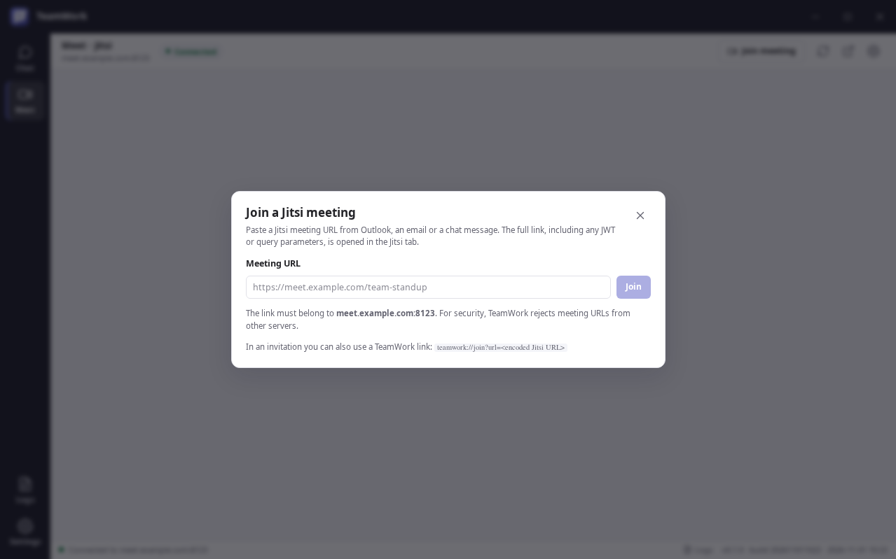

# TeamWork

TeamWork is a Linux desktop client that puts **Element (Matrix)** chat and **Jitsi Meet** calling into one Teams-like window.

**Latest build:** `0.1.0` · build `202611011022` · `2026-11-01 10:22 UTC`

**Users:** [Get started](#the-easy-way-to-get-running)<br />
**Administrators:** [Enterprise readiness](docs/enterprise-readiness.md) · [Enterprise policy](docs/policy.md) · [Packaging](docs/packaging.md)<br />
**Developers:** [Build from source](#developer-quick-start) · [Architecture](docs/architecture.md)

<p align="center">
  
  
</p>

*Left: settings, configuration and build metadata. Right: joining a Jitsi meeting from an Outlook/email URL.*

---

## The easy way to get running

You need three things before you start:

1. A Linux desktop (x86_64).
2. The **Element URL** and **Jitsi Meet URL** from your IT team.
3. Your normal work account for those services.

**TeamWork is only the desktop client.** It does not install or host Element, Matrix, Jitsi, or your identity provider. If you do not have those services yet, ask your IT team for the URLs or see [Element](https://element.io/) and [Jitsi](https://jitsi.org/).

### 1. Download and install

Download the package from [GitHub Releases](https://github.com/RogerBergling/TeamWork/releases). If no release has been published yet, use the files in the [`release/` folder](https://github.com/RogerBergling/TeamWork/tree/main/release).

| Package | Use this if | Install |
|---|---|---|
| **AppImage** | You want to try it without installing | `chmod +x TeamWork-*.AppImage` then run it |
| **.deb** | You use Ubuntu/Debian | `sudo apt install ./TeamWork-*.deb` |
| **.rpm** | You use Fedora/RHEL/SUSE | `sudo dnf install ./TeamWork-*.rpm` |

For a managed company laptop, prefer the **deb** or **rpm**. For a quick test, use the AppImage. If FUSE is unavailable, run the AppImage with `APPIMAGE_EXTRACT_AND_RUN=1`.

### 2. Open TeamWork

Start TeamWork from your application menu or run the file you downloaded.

On first launch it opens **Settings**. If it does not, select **Settings** in the left navigation rail.

### 3. Point it at your servers

Open **Settings → Connection** and enter:

- **Element URL** — for example `https://element.example.com`
- **Jitsi Meet URL** — for example `https://meet.example.com`

Click **Save changes**.

### 4. Sign in normally

Open **Chat** or **Meet** and sign in through the normal web page. TeamWork does not ask for your password and does not store your credentials.

If your organization uses SAML/OpenID, the usual login, MFA and consent pages appear inside TeamWork.

### 5. Start using it

- **Chat** opens Element for rooms, spaces, direct messages and files.
- **Meet** opens Jitsi for video meetings.
- **Join meeting** (`Ctrl+J`) lets you paste a Jitsi link from Outlook, email or chat.
- **Settings** controls servers, branding, theme, proxy, logging and authentication.
- **Logs** shows errors and warnings; enable **Debug mode** if support asks for more detail.

### Optional: make normal Outlook links open in TeamWork

A normal `https://meet.example.com/...` link opens the browser. To make those links open TeamWork automatically, install the optional Chrome/Edge extension:

- [Browser extension guide](docs/browser-extension.md)
- The unpacked extension is in `browser-extension/dist`.
- Configure your trusted Jitsi and Element domains in the extension options.

You can skip the extension. Copying a Jitsi link into **Join meeting** works without it.

### First-launch checklist

- [ ] Element URL and Jitsi URL are saved.
- [ ] Chat sign-in works.
- [ ] Meet sign-in works.
- [ ] Camera and microphone permission is granted.
- [ ] A test Jitsi meeting opens.
- [ ] Screen sharing works (Linux desktop portal / PipeWire).
- [ ] Optional: the browser extension is installed and configured.

## Common first-launch problems

| Problem | What to check |
|---|---|
| Blank Element or Jitsi page | URL typo, VPN/network access, DNS, proxy, or certificate trust |
| Login works in Chrome but not TeamWork | Check **Authentication → Trusted authentication origins**, or ask support about the user-agent override |
| “Invalid certificate” | Install your organization’s CA system-wide; use the certificate training option only for controlled internal testing |
| Jitsi link opens the browser | Install the browser extension, or use **Meet → Join meeting** and paste the link |
| Screen sharing has no sources | Check `xdg-desktop-portal` and PipeWire; try the X11 backend from Settings if needed |
| AppImage will not start | Check FUSE; try `APPIMAGE_EXTRACT_AND_RUN=1` or install the deb/rpm |
| No automatic updates | Install a newer package from Releases; auto-update is not yet implemented |

## What you get

- One Teams-like window for Element chat and Jitsi meetings.
- The official Element and Jitsi web clients, not reduced copies.
- SAML/OpenID login through the normal web flow.
- Configurable logo, name, theme, accent colour and density.
- GUI-editable settings stored in one JSON file.
- Logs, debug mode, screen sharing, tray support and Wayland support.
- AppImage, deb and rpm packages for Linux.
- An optional Chrome/Edge extension for normal HTTPS meeting links.

## Important: what TeamWork does not do

- It does not host Element, Matrix, Jitsi or your identity provider.
- It does not create user accounts.
- It does not replace your organization’s SSO configuration.
- It does not unify Matrix and Jitsi identities; that is a server-side identity decision.
- It does not yet provide automatic calendar discovery, auto-update, or a unified cross-application notification list.

---

# For developers and administrators

## Current build

| Version | Build number | Build date | Build time | Hour |
|---|---|---|---|---|
| `0.1.0` | `202611011022` | `2026-11-01` | `10:22 UTC` | `10` |

Build metadata is generated at build time and shown in the application status bar, **Settings → Application**, and the **About** dialog. CI uses the workflow run number as the build number; local builds derive it from the UTC timestamp.

Override build metadata when needed:

```bash
BUILD_NUMBER=202611011022 \
BUILD_TIMESTAMP=2026-11-01T10:22:00Z \
npm run dist
```

`SOURCE_DATE_EPOCH` is also supported for reproducible timestamps.

## Why this design

Element and Jitsi are large, fast-moving web applications built on Matrix and WebRTC. Reimplementing them natively would be a multi-year project and would permanently lag upstream. TeamWork therefore hosts each official client in an isolated `WebContentsView`:

```text
┌────────────────────────────────────────────────────────┐
│  TeamWork title bar · logo · organisation · window UI   │
├──────────┬─────────────────────────────────────────────┤
│  Chat    │  Element Web (Matrix)                       │
│  Meet    │  Jitsi Meet (WebRTC)                        │
│  Logs    │                                             │
│  Settings│  native shell + configuration + logging      │
└──────────┴─────────────────────────────────────────────┘
```

This is also why the application can support the complete Jitsi and Element feature sets: it displays the real clients, not a reduced copy.

## Features

- **One Teams-like application** with a dark navigation rail, contextual header, status bar, and light/dark themes.
- **Element and Jitsi side by side**, each with a persistent, isolated browser session.
- **Lazy-loaded content**; Jitsi is not loaded until the user opens Meet or joins a meeting.
- **Startup timing diagnostics** in the main log and a tuned renderer bundle without Zod.
- **Join Jitsi meetings from a URL** using the Join meeting dialog (`Ctrl+J`) or a `teamwork://join?...` deep link from Outlook, email, or chat.
- **Chrome/Edge Link Opener extension** that converts ordinary Jitsi and Matrix/Element HTTPS links into TeamWork deep links, with trusted-domain and public-service detection.
- **Web-based authentication preserved**, including SAML and OpenID redirect flows and login popups.
- **Optional system-browser SSO** for identity providers that reject embedded browsers, with an origin-validated `teamwork://auth` callback.
- **Every TeamWork setting editable in the GUI**, saved to a single JSON file.
- **Read-only enterprise policy** at `/etc/teamwork/policy.json` that locks managed fields in the GUI and is enforced by the main process.
- **Configurable branding**: application name, organisation, accent colour, theme, density, and custom logo.
- **Structured logging** with error, warning, info, and debug levels; a GUI debug switch; live log viewer; log rotation.
- **Linux packages**: AppImage, `.deb`, and `.rpm` from the same codebase.
- **Wayland support** with PipeWire screen sharing, plus an X11 fallback.
- **Screen-share picker** for screens and windows.
- **`teamwork://` protocol registration** for deb/rpm packages and automatic AppImage registration on first run.
- **Per-application user-agent overrides** for identity providers that reject embedded browsers.
- **Proxy support** (system, direct, or custom HTTP/SOCKS).
- **Optional tray integration**, close-to-tray, and remembered window geometry.
- **Isolated sessions and permissions**; no `nodeIntegration` in any embedded page.

## Requirements

- Linux x86_64 (ARM64 packaging is possible but not yet tested).
- Node.js **22.12 or newer** and npm for development.
- Runtime libraries normally present on a desktop Linux installation (GTK 3, NSS, ALSA, GBM, X11/Wayland).
- `rpmbuild` only when producing an RPM package (`sudo apt install rpm` on Ubuntu/Debian).
- `zip` when packaging the browser extension.

## Developer quick start

```bash
npm ci
npm run dev
```

On first launch, open **Settings → Connection** and enter your Element and Jitsi URLs. The clients load from those URLs; TeamWork does not bundle the servers.

To join a meeting from an invite, open **Meet** and click **Join meeting** (`Ctrl+J`), then paste the Jitsi link. See [Deep links](docs/deep-links.md).

For automatic conversion of normal HTTPS links, see [Browser extension](docs/browser-extension.md).

## Build and package

```bash
npm run verify        # typecheck + tests + builds + extension validation
npm run smoke         # real Electron smoke test (needs a display or Xvfb)
npm run dist          # AppImage + deb + rpm + extension zip in release/
```

Individual targets:

```bash
npm run dist:appimage
npm run dist:deb
npm run dist:rpm      # requires rpmbuild on the build machine
```

The AppImage is a single self-contained executable file. The `.deb` and `.rpm` are normal installers for managed fleets. For managed fleets, prefer the installed deb/rpm over the AppImage for faster repeat launches and package-manager updates. See [Performance](docs/performance.md) and [Packaging](docs/packaging.md).

## Configuration

All user settings live in one file:

```text
~/.config/teamwork/config.json
```

The GUI writes this file atomically. Invalid files are backed up with an `.invalid-<timestamp>` suffix and replaced with defaults. Logs are written to:

```text
~/.local/state/teamwork/logs/teamwork.log
```

For isolated test or portable profiles, override the locations with:

```bash
TEAMWORK_CONFIG_DIR=/path/to/profile
TEAMWORK_STATE_DIR=/path/to/state
```

A managed deployment can enforce settings with a read-only policy file. See [Enterprise policy](docs/policy.md).

See [Configuration reference](docs/configuration.md) for every field.

## Authentication

Authentication is performed by the embedded Element and Jitsi web clients, so the sign-in method configured on your servers is used unchanged. TeamWork does not capture passwords or tokens.

- SAML and OpenID redirects and popups are kept inside the application by default.
- Add your IdP origins under **Authentication → Trusted authentication origins** to send unrelated links to the system browser while keeping SSO in-app.
- **Use the system browser for SSO** hands trusted IdP navigations to your default browser. The IdP must return to `teamwork://auth`; see [Authentication](docs/authentication.md#system-browser-sso-fallback). This is an origin-validated handoff, not a cookie-sharing mechanism.
- Some identity providers reject embedded browsers. The per-application user-agent override is the first workaround; use system-browser SSO if the IdP supports a custom-scheme callback.
- Matrix and Jitsi still have separate identities unless your deployment federates them through a shared IdP. The client does not merge accounts automatically.
- Invalid internal TLS certificates can be accepted explicitly for private CA deployments; every exception is logged as a warning.

Read [Authentication](docs/authentication.md) for SAML/OpenID, Jitsi JWT, certificate, and session details.

## Wayland

TeamWork requests the Wayland backend automatically and falls back to X11. The display backend and hardware acceleration can be changed under **Settings → Linux integration** and **Advanced** (restart required).

Screen sharing uses `xdg-desktop-portal` and PipeWire. Make sure the portal and a PipeWire session are running. If portal capture is unavailable, switch the display backend to **X11 / XWayland** as a fallback. System-audio capture is not exposed because Electron only supports loopback audio capture on Windows; the desktop portal remains responsible for audio policy.

## Logging and diagnostics

- Debug output is enabled with **Settings → Logging → Debug mode**; it can be toggled while the application is running.
- The **Logs** view shows the live log file, filters lines, opens the log folder, and clears the file.
- Embedded Element/Jitsi console messages are included only in debug mode.
- The main process catches uncaught exceptions and unhandled rejections.

## Security model

- Shell renderer: `contextIsolation: true`, app-wide Chromium sandbox, no Node integration, strict preload bridge.
- Element and Jitsi: separate persistent partitions, no preload, no Node integration, sandboxed.
- Packaged Electron runtime disables `ELECTRON_RUN_AS_NODE`, `NODE_OPTIONS`, and inspector flags, loads only from the ASAR, and enables cookie encryption.
- Permission requests (camera, microphone, screen capture, notifications) are granted automatically only for the configured application origin; other origins require an explicit dialog.
- External links open in the system browser when trusted authentication origins are configured.
- Non-HTTP(S) navigation and redirect targets are blocked. `mailto:` and `tel:` links are handed to the system handler.
- Packaged builds refuse remote-debugging and Node-inspector switches.
- A read-only system policy can lock managed settings; the main process enforces it even if the user edits the JSON file.
- The log file is created with mode `0600` inside a `0700` state directory.
- Custom CSS is user-controlled local configuration, not remote input.
- Sessions can be cleared per application or automatically on exit.

Administrators should review [Enterprise readiness](docs/enterprise-readiness.md) and [Enterprise policy](docs/policy.md) before a managed rollout.

## Repository layout

```text
src/main/          Electron main process, configuration, sessions, windows
src/preload/       Narrow contextBridge API
src/renderer/      React shell, settings, logs, screen-share picker
src/shared/        Settings schema, URL policy, deep links, shared types
browser-extension/ Chrome/Edge Manifest V3 Link Opener (source + built dist)
tests/             Unit tests for schema, URL policy, deep links, stores
docs/              Architecture, configuration, authentication, packaging
build/             Icons and packaging resources
scripts/           Icon and extension packaging scripts
```

## Validation performed

The repository is validated with:

- `npm run verify` — type checks, 89 unit tests, production builds, extension packaging, and manifest validation
- `npm test` — 89 tests across settings, URL policy, deep links, auth callbacks, policy enforcement, pending-auth markers, extension matching, config store, window state, paths, startup timing, and build metadata
- A real Electron smoke test under Xvfb, including loading both embedded views from a local server
- Deep-link launch and Join-dialog submission, including preservation of the full Jitsi URL
- Launching the built **AppImage**, extracted **.deb**, and extracted **.rpm** with the smoke test
- AppImage self-registration verified with `xdg-mime query default x-scheme-handler/teamwork`
- Browser extension built, manifest-validated, and packaged; link matching, SafeLinks unwrapping, Jitsi/Matrix conversion covered by unit tests
- Tag-based GitHub Release workflow for AppImage, deb, rpm, extension zip, and checksums

## Known limitations

- Element and Jitsi run as embedded web applications, so their internal navigation and settings stay inside their own interfaces. TeamWork cannot mirror every upstream option into the native settings file.
- There is no unified cross-application search, notification list, or presence model; those remain features of Element/Jitsi.
- Jitsi calls launched from Element rely on your deployment's Jitsi widget configuration. The dedicated Jitsi tab always provides the full standalone client.
- Normal Jitsi HTTPS links open the browser unless the Chrome/Edge extension is installed, or a `teamwork://join?...` link is used. Automatic calendar discovery would still require ICS or Microsoft Graph integration.
- The browser extension is Chromium-only (Chrome/Edge). Mobile browsers and non-Chromium browsers are not covered.
- External-browser SSO requires the IdP to redirect to `teamwork://auth` and to return a URL or token the embedded Element/Jitsi client accepts. The system browser and the embedded session do not share cookies.
- No desktop auto-update mechanism yet; updates are delivered by replacing the AppImage or installing a newer package. The browser extension can use a self-hosted `update_url`.
- Element Web is AGPL-3.0. TeamWork loads it from your server by default and does not redistribute Element. If you bundle a modified Element build, AGPL obligations apply. See [Third-party notices](THIRD_PARTY_NOTICES.md).

## License

The TeamWork shell is licensed under the Apache License 2.0. Element, Jitsi, Electron, and other dependencies retain their own licenses. See [LICENSE](LICENSE) and [THIRD_PARTY_NOTICES.md](THIRD_PARTY_NOTICES.md).

---

Documentation: [Architecture](docs/architecture.md) · [Configuration](docs/configuration.md) · [Enterprise policy](docs/policy.md) · [Authentication](docs/authentication.md) · [Deep links](docs/deep-links.md) · [Browser extension](docs/browser-extension.md) · [Packaging](docs/packaging.md) · [Performance](docs/performance.md) · [Enterprise readiness](docs/enterprise-readiness.md) · [Roadmap](docs/roadmap.md)

Project: [Contributing](CONTRIBUTING.md) · [Security policy](SECURITY.md) · [Changelog](CHANGELOG.md)

---

## Development note

This project was developed with AI assistance and human review. The maintainer
defines the requirements, threat model, edge cases and acceptance criteria; AI
helps write and refactor code; the maintainer tests, breaks and verifies it.
The software is provided as-is, without warranty. See
[How this was built](https://apps.bergling.net/how-this-was-built/) for the
longer explanation.
