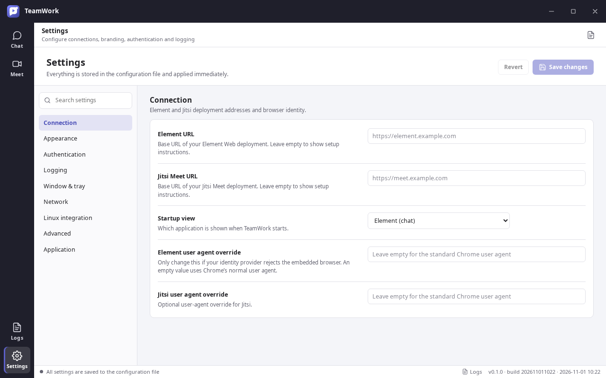

# TeamWork

A Teams-inspired Linux desktop client that brings **Element (Matrix)** and **Jitsi Meet** together in one window.

TeamWork is a native Electron shell around the official web clients. It does not reimplement chat or conferencing. Element and Jitsi keep their own features, SAML/OpenID sign-in flows, and upstream behaviour, while TeamWork adds a consistent desktop frame, branding, configuration, logging, and Linux integration.



## Why this design

Element and Jitsi are large, fast-moving web applications built on Matrix and WebRTC. Reimplementing them natively would be a multi-year project and would permanently lag upstream. TeamWork therefore hosts each official client in an isolated `WebContentsView`:

```text
┌────────────────────────────────────────────────────────┐
│  TeamWork title bar · logo · organisation · window UI   │
├──────────┬─────────────────────────────────────────────┤
│  Chat    │  Element Web (Matrix)                       │
│  Meet    │  Jitsi Meet (WebRTC)                        │
│  Logs    │                                             │
│  Settings│  native shell + configuration + logging      │
└──────────┴─────────────────────────────────────────────┘
```

This is also why the application can support the complete Jitsi and Element feature sets: it displays the real clients, not a reduced copy.

## Features

- **One Teams-like application** with a dark navigation rail, contextual header, status bar, and light/dark themes.
- **Element and Jitsi side by side**, each with a persistent, isolated browser session.
- **Join Jitsi meetings from a URL** using the Join meeting dialog (`Ctrl+J`) or a `teamwork://join?...` deep link from Outlook, email, or chat.
- **Chrome/Edge Link Opener extension** that converts ordinary Jitsi and Matrix/Element HTTPS links into TeamWork deep links, with trusted-domain and public-service detection.
- **Web-based authentication preserved**, including SAML and OpenID redirect flows and login popups.
- **Every TeamWork setting editable in the GUI**, saved to a single JSON file.
- **Configurable branding**: application name, organisation, accent colour, theme, density, and custom logo.
- **Structured logging** with error, warning, info, and debug levels; a GUI debug switch; live log viewer; log rotation.
- **Linux packages**: AppImage, `.deb`, and `.rpm` from the same codebase.
- **Wayland support** with PipeWire screen sharing, plus an X11 fallback.
- **Screen-share picker** for screens and windows.
- **`teamwork://` protocol registration** for deb/rpm packages and automatic AppImage registration on first run.
- **Per-application user-agent overrides** for identity providers that reject embedded browsers.
- **Proxy support** (system, direct, or custom HTTP/SOCKS).
- **Optional tray integration**, close-to-tray, and remembered window geometry.
- **Isolated sessions and permissions**; no `nodeIntegration` in any embedded page.

## Requirements

- Linux x86_64 (ARM64 packaging is possible but not yet tested).
- Node.js **22.12 or newer** and npm for development.
- Runtime libraries normally present on a desktop Linux installation (GTK 3, NSS, ALSA, GBM, X11/Wayland).
- `rpmbuild` only when producing an RPM package (`sudo apt install rpm` on Ubuntu/Debian).

## Quick start

```bash
npm ci
npm run dev
```

On first launch, open **Settings → Connection** and enter:

- **Element URL** — for example `https://element.example.com`
- **Jitsi Meet URL** — for example `https://meet.example.com`

The clients load from those URLs. TeamWork does not bundle Element or Jitsi servers.

To join a meeting from an invite, open the **Meet** view and click **Join meeting** (`Ctrl+J`), then paste the Jitsi link. See [Deep links](docs/deep-links.md) for clickable `teamwork://` invitation links.

For automatic conversion of normal HTTPS links, install the [Chrome/Edge extension](docs/browser-extension.md). The unpacked extension is in `browser-extension/dist`; a packaged zip is produced in `release/`.

## Build and package

```bash
npm run typecheck     # TypeScript checks for main, preload, and renderer
npm test              # 59 unit tests
npm run build         # production bundles in out/
npm run smoke         # real Electron smoke test (needs a display or Xvfb)
npm run extension:build
npm run extension:zip # Chrome/Edge zip in release/
npm run dist          # AppImage + deb + rpm (+ extension zip) in release/
```

Individual targets:

```bash
npm run dist:appimage
npm run dist:deb
npm run dist:rpm      # requires rpmbuild on the build machine
```

The AppImage is a single self-contained executable file. The `.deb` and `.rpm` are normal installers for managed fleets. All three are build outputs of the same application; see [Packaging](docs/packaging.md).

## Configuration

All settings live in one file:

```text
~/.config/teamwork/config.json
```

The GUI writes this file atomically. Invalid files are backed up with an `.invalid-<timestamp>` suffix and replaced with defaults. Logs are written to:

```text
~/.local/state/teamwork/logs/teamwork.log
```

For isolated test or portable profiles, override the locations with:

```bash
TEAMWORK_CONFIG_DIR=/path/to/profile
TEAMWORK_STATE_DIR=/path/to/state
```

See [Configuration reference](docs/configuration.md) for every field.

## Authentication

Authentication is performed by the embedded Element and Jitsi web clients, so the sign-in method configured on your servers is used unchanged. TeamWork does not capture passwords or tokens.

- SAML and OpenID redirects and popups are kept inside the application by default.
- Add your IdP origins under **Authentication → Trusted authentication origins** to send unrelated links to the system browser while keeping SSO in-app.
- Some identity providers reject embedded browsers. The per-application user-agent override is the first workaround; a provider that mandates a separate system browser cannot be supported end-to-end yet.
- Matrix and Jitsi still have separate identities unless your deployment federates them through a shared IdP. The client does not merge accounts automatically.
- Invalid internal TLS certificates can be accepted explicitly for private CA deployments; every exception is logged as a warning.

Read [Authentication](docs/authentication.md) for SAML/OpenID, Jitsi JWT, certificate, and session details.

## Wayland

TeamWork requests the Wayland backend automatically and falls back to X11. The display backend and hardware acceleration can be changed under **Settings → Linux integration** and **Advanced** (restart required).

Screen sharing uses `xdg-desktop-portal` and PipeWire. Make sure the portal and a PipeWire session are running. If portal capture is unavailable, switch the display backend to **X11 / XWayland** as a fallback. System-audio capture is not exposed because Electron only supports loopback audio capture on Windows; the desktop portal remains responsible for audio policy.

## Logging and diagnostics

- Debug output is enabled with **Settings → Logging → Debug mode**; it can be toggled while the application is running.
- The **Logs** view shows the live log file, filters lines, opens the log folder, and clears the file.
- Embedded Element/Jitsi console messages are included only in debug mode.
- The main process catches uncaught exceptions and unhandled rejections.

## Security model

- Shell renderer: `contextIsolation: true`, `sandbox: true`, no Node integration, strict preload bridge.
- Element and Jitsi: separate persistent partitions, no preload, no Node integration, sandboxed.
- Permission requests (camera, microphone, screen capture, notifications) are granted automatically only for the configured application origin; other origins require an explicit dialog.
- External links open in the system browser when trusted authentication origins are configured.
- Custom CSS is user-controlled local configuration, not remote input.
- Sessions can be cleared per application or automatically on exit.

## Repository layout

```text
src/main/          Electron main process, configuration, sessions, windows
src/preload/       Narrow contextBridge API
src/renderer/      React shell, settings, logs, screen-share picker
src/shared/        Settings schema, URL policy, deep links, shared types
browser-extension/ Chrome/Edge Manifest V3 Link Opener (source + built dist)
tests/             Unit tests for schema, URL policy, deep links, stores
docs/              Architecture, configuration, authentication, deep links, packaging
build/             Icons and packaging resources
scripts/           Icon and extension packaging scripts
```

## Validation performed

The repository is validated with:

- `npm run typecheck`
- `npm test` — 59 tests across settings, URL policy, deep links, extension link matching, config store, window state, and paths
- `npm run build`
- A real Electron smoke test under Xvfb, including loading both embedded views from a local server
- Deep-link launch and Join-dialog submission, including preservation of the full Jitsi URL
- Launching the built **AppImage**, extracted **.deb**, and extracted **.rpm** with the smoke test
- AppImage self-registration verified with `xdg-mime query default x-scheme-handler/teamwork`
- Browser extension built and packaged; link matching, SafeLinks unwrapping, Jitsi/Matrix conversion covered by unit tests

## Known limitations

- Element and Jitsi run as embedded web applications, so their internal navigation and settings stay inside their own interfaces. TeamWork cannot mirror every upstream option into the native settings file.
- There is no unified cross-application search, notification list, or presence model; those remain features of Element/Jitsi.
- Jitsi calls launched from Element rely on your deployment's Jitsi widget configuration. The dedicated Jitsi tab always provides the full standalone client.
- Normal Jitsi HTTPS links open the browser unless the Chrome/Edge extension is installed, or a `teamwork://join?...` link is used. Automatic calendar discovery would still require ICS or Microsoft Graph integration.
- The browser extension is Chromium-only (Chrome/Edge). Mobile browsers and non-Chromium browsers are not covered.
- No auto-update mechanism yet; updates are delivered by replacing the AppImage or installing a newer package.
- Element Web is AGPL-3.0. TeamWork loads it from your server by default and does not redistribute Element. If you bundle a modified Element build, AGPL obligations apply. See [Third-party notices](THIRD_PARTY_NOTICES.md).

## License

The TeamWork shell is licensed under the Apache License 2.0. Element, Jitsi, Electron, and other dependencies retain their own licenses. See [LICENSE](LICENSE) and [THIRD_PARTY_NOTICES.md](THIRD_PARTY_NOTICES.md).

---

Documentation: [Architecture](docs/architecture.md) · [Configuration](docs/configuration.md) · [Authentication](docs/authentication.md) · [Deep links](docs/deep-links.md) · [Browser extension](docs/browser-extension.md) · [Packaging](docs/packaging.md)
